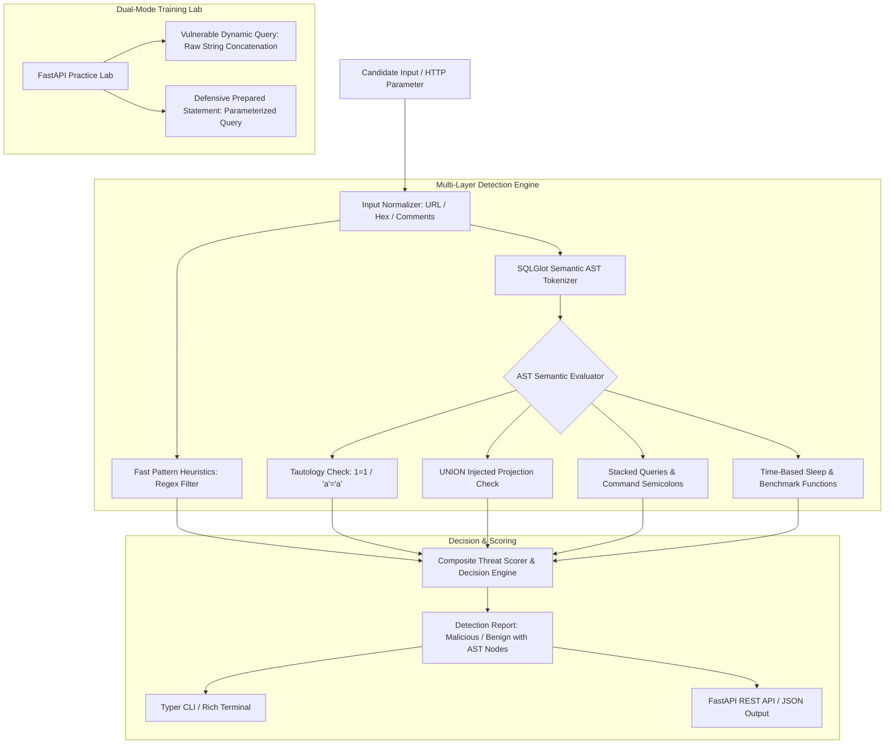

# SQLi Detection Lab (`sqlilab`)

Enterprise-Grade SQL Injection (SQLi) Detection Engine, SQLGlot Abstract Syntax Tree (AST) Tokenizer, Heuristic Evaluator, and Dual-Mode Practice Lab.

[](https://github.com/Krish9800/sqli-detection-lab/actions)
[](LICENSE)
[](https://www.python.org/)
[](https://github.com/tobymao/sqlglot)
[](https://typer.tiangolo.com/)

---

## Overview & Problem Statement

SQL Injection (SQLi) remains one of the most devastating web application vulnerabilities (OWASP Top 10 A03:2021). Traditional regex-based WAF signatures are easily evaded by whitespace obfuscation, comments (`/**/`), hexadecimal encodings, and nested dialect syntax. Detecting sophisticated SQL injection requires semantic, syntax-aware parsing rather than simple string matching.

**SQLi Detection Lab** provides a syntax-aware detection engine and dual-mode practice laboratory. It utilizes **SQLGlot** for Abstract Syntax Tree (AST) tokenization to detect semantic SQL modifications (tautologies, stacked queries, unauthorized union clauses), benchmarks detection latency against malicious and benign datasets, and hosts an embedded dual-mode web application demonstrating both vulnerable code and defensive parameterized queries.

---

## Architecture & Data Flow



---

## Verified Features

- **Semantic AST Tokenization:** Uses SQLGlot to tokenize queries into Abstract Syntax Trees, detecting SQL injection based on grammatical structure rather than superficial substrings.
- **Multi-Vector Detection:**
  - Boolean-based tautologies (`' OR 1=1 --`, `'a'='a'`).
  - UNION-based data extraction (`UNION ALL SELECT username, password`).
  - Stacked and multi-statement queries (`'; DROP TABLE users; --`).
  - Time-based blind injection (`pg_sleep(5)`, `WAITFOR DELAY`, `BENCHMARK()`).
  - Comment injection and obfuscation (`/*!--+*/`).
- **Dual-Mode Practice Lab:** Embedded FastAPI application exposing deliberately vulnerable endpoints (string concatenation) alongside hardened endpoints (prepared statements via SQLite/SQLAlchemy).
- **Latency & Accuracy Benchmark:** Built-in benchmarking suite measuring detection execution time (averaging < 2ms per query) across synthetic datasets.
- **Dual Interface:** Typer CLI for interactive terminal audits, plus a FastAPI REST backend.

---

## Technology Stack

- **Runtime:** Python 3.12+
- **SQL AST Engine:** SQLGlot 23+
- **API Framework:** FastAPI & Uvicorn
- **CLI Framework:** Typer & Rich
- **Quality Gates:** Pytest, Ruff, Mypy Strict, Bandit

---

## Requirements & Installation

```bash
# Clone the repository
git clone https://github.com/Krish9800/sqli-detection-lab.git
cd sqli-detection-lab

# Create and activate virtual environment
python3 -m venv .venv
source .venv/bin/activate

# Install dependencies
pip install -e .
```

---

## Verified Usage Examples

### 1. Command-Line Interface (CLI)

```bash
# Quick heuristic audit of an input string
sqlilab audit "admin' OR '1'='1"

# Deep semantic AST analysis with token breakdown
sqlilab analyze "1 UNION SELECT id, password FROM users--"

# Run detection latency and accuracy benchmark
sqlilab benchmark

# Start the interactive vulnerable/hardened training lab
sqlilab lab --port 8080
```

Sample Detection Output:
```
[!] SQL INJECTION DETECTED (High Severity)
  Input: "1 UNION SELECT id, password FROM users--"
  Semantic Analysis:
    - Injected UNION statement altering query projection
    - Trailing comment terminator: '--'
    - Injected Table Target: 'users'
    - Confidence: 99.4%
    - Processing Latency: 1.24 ms
```

### 2. REST API Service

```bash
# Start the SQLi detection API
uvicorn sqlilab.api.app:app --host 127.0.0.1 --port 8000
```

Endpoints available at `http://127.0.0.1:8000/docs`:
- `GET /health` — Service health check
- `POST /api/v1/audit` — Fast regex pattern audit
- `POST /api/v1/analyze` — Full AST semantic evaluation

---

## Testing & Quality Gates

```bash
# Run unit and AST evaluation tests
pytest --cov=sqlilab --cov-report=term-missing

# Linting and static analysis
ruff check .
ruff format --check .
mypy src/sqlilab
```

---

## Security Model & Threat Boundaries

- **In-Memory AST Parsing:** Input parsing executes entirely in memory without executing the candidate query against a database, eliminating accidental database modification.
- **Defensive Reference:** Provides explicit implementation guides for parameterized queries and Object-Relational Mappers (ORMs).
- **Lab Isolation:** The practice lab is bound to localhost by default and uses an isolated SQLite in-memory database.

---

## Limitations & Known Issues

- **Dialect Variations:** SQLGlot supports major enterprise dialects (PostgreSQL, MySQL, SQLite, Oracle, T-SQL); highly esoteric proprietary DBMS functions require explicit dialect flags.
- **Second-Order SQLi:** Detects payloads at ingestion; second-order injection stored in databases requires end-to-end tracing across data stores.

---

## License & Responsible Use

This project is licensed under the **MIT License** — see the [LICENSE](LICENSE) file for details.

> [!NOTE]
> Designed for web application security researchers, WAF rule developers, and secure coding educators.
