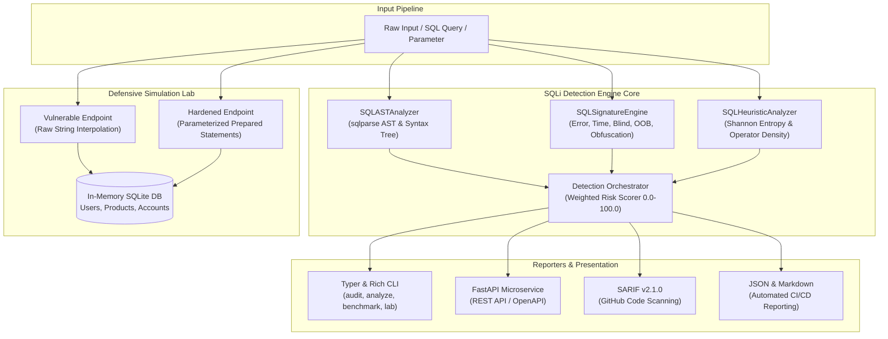

# SQLi Detection Lab Architecture Specification

## 1. System Overview

`sqlilab` is an enterprise-grade SQL injection detection framework and interactive defensive laboratory designed for Application Security (AppSec) engineers, blue teams, and developers. It combines lexical/AST syntax tree inspection, multi-vector regex signatures, and information-theoretic Shannon entropy analysis to detect in-band, blind, out-of-band, and obfuscated SQL injection payloads with low false-positive rates.

## 2. Core Detection Subsystems

### 2.1 Syntactic AST Analyzer (`SQLASTAnalyzer`)
- Deconstructs raw SQL statements and parameter fragments into token streams using `sqlparse`.
- Detects boolean tautologies (`' OR '1'='1`, `OR 1=1`, `AND 'a'='a'`).
- Detects comment injection breakouts (`--`, `/* ... */`, `#`).
- Identifies stacked execution patterns via semicolon delimiters (`1; DROP TABLE ...`).
- Inspects UNION injection clauses across compound SELECT queries.
- Audits quote and parenthesis parity imbalances signaling syntax breakout attempts.

### 2.2 Multi-Vector Signature Engine (`SQLSignatureEngine`)
- **Error-Based XML & Cast**: XPath extraction (`EXTRACTVALUE`, `UPDATEXML`), cast errors (`CONVERT(int, ...)`).
- **Time-Based Blind**: Latency induction (`SLEEP()`, `WAITFOR DELAY`, `pg_sleep()`, `BENCHMARK()`).
- **Boolean-Blind Extraction**: Substring and ASCII ordinal probing (`SUBSTRING()`, `ASCII()`, `MID()`).
- **Out-of-Band & System Execution**: `xp_cmdshell`, `INTO OUTFILE`, `LOAD_FILE()`, `UTL_HTTP`.
- **Metadata Enumeration**: `information_schema.tables`, `sys.objects`, `pg_catalog`.
- **Dynamic Obfuscation**: String reconstruction via `CHAR()`, `CHR()`, `UNHEX()`, and comment splitting.

### 2.3 Heuristic & Shannon Entropy Scorer (`SQLHeuristicAnalyzer`)
- Calculates Shannon information entropy ($H(X) = -\sum p(x) \log_2 p(x)$) to identify high-entropy random buffers, hex obfuscation, and Base64 payloads.
- Measures operator character density ratios (quotes, semicolons, dashes, equals signs).
- Calculates SQL keyword density ratios to spot keyword packing in untrusted parameters.

### 2.4 Risk Scoring Matrix

| Risk Level | Score Range | Primary Triggers | Action Guidance |
| :--- | :--- | :--- | :--- |
| **MALICIOUS** | $70.0 - 100.0$ | Tautology, Stacked Queries, Time/Error Signatures | Block request immediately; trigger security alert |
| **SUSPICIOUS** | $30.0 - 69.9$ | High entropy, operator clustering without explicit signature | Challenge with CAPTCHA or log for investigation |
| **CLEAN** | $0.0 - 29.9$ | Safe queries, alphanumeric input, normal entropy | Allow execution through parameterized statements |

## 3. Dual-Mode Defensive Laboratory

The embedded database lab features an in-memory SQLite instance pre-seeded with fixtures across three tables (`users`, `products`, `accounts`). It provides side-by-side comparison of execution behaviors:
- **Insecure Mode**: Demonstrates real-world exploitation impacts including table dumps, authentication bypasses, and multi-statement execution.
- **Hardened Mode**: Implements prepared statements with bound parameters (`?` placeholders), neutralizing injection vectors completely.
